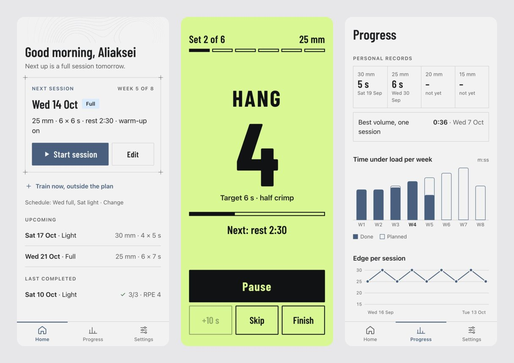
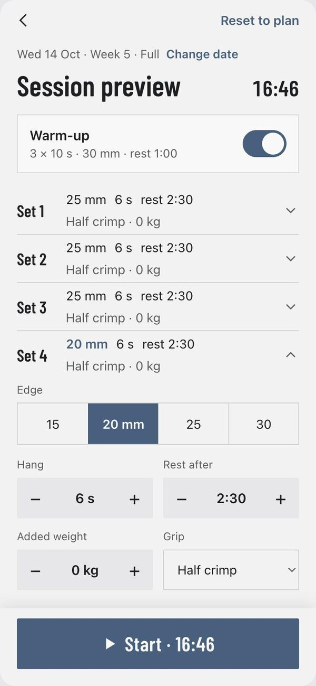
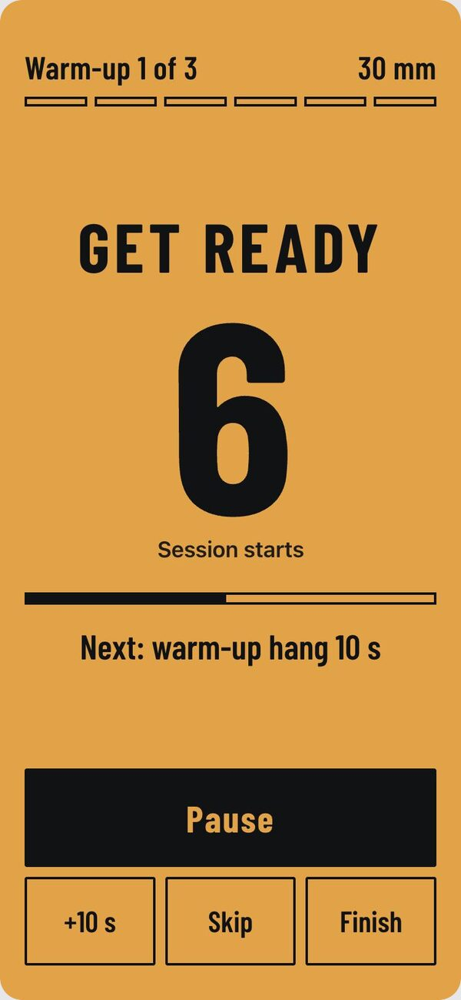
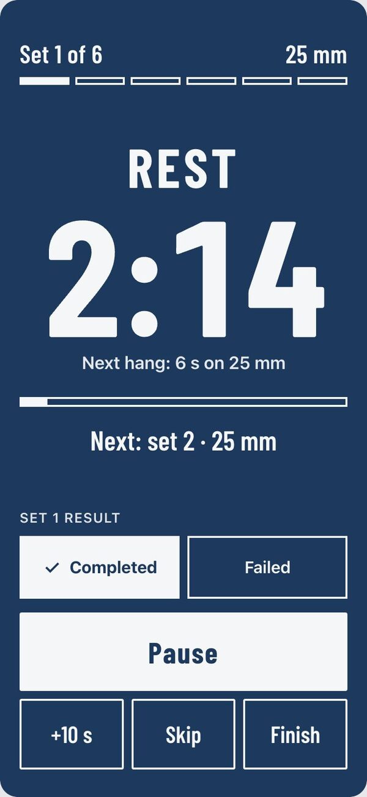
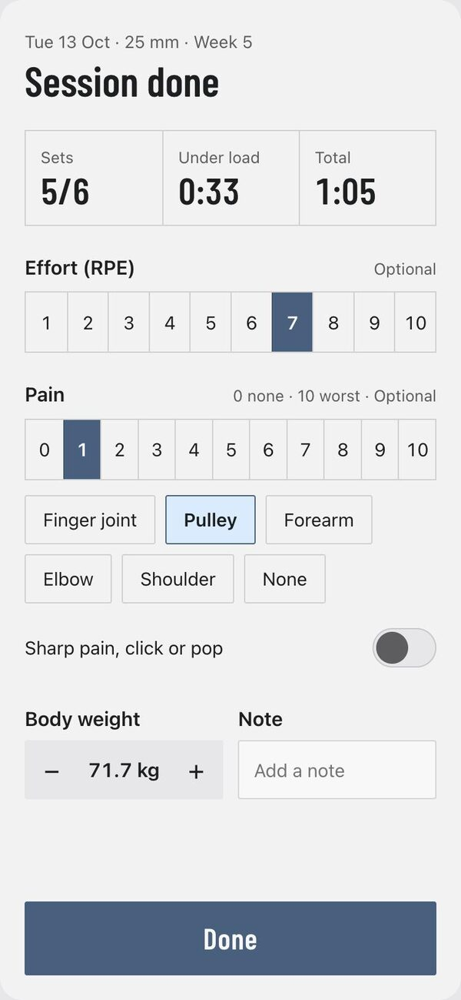
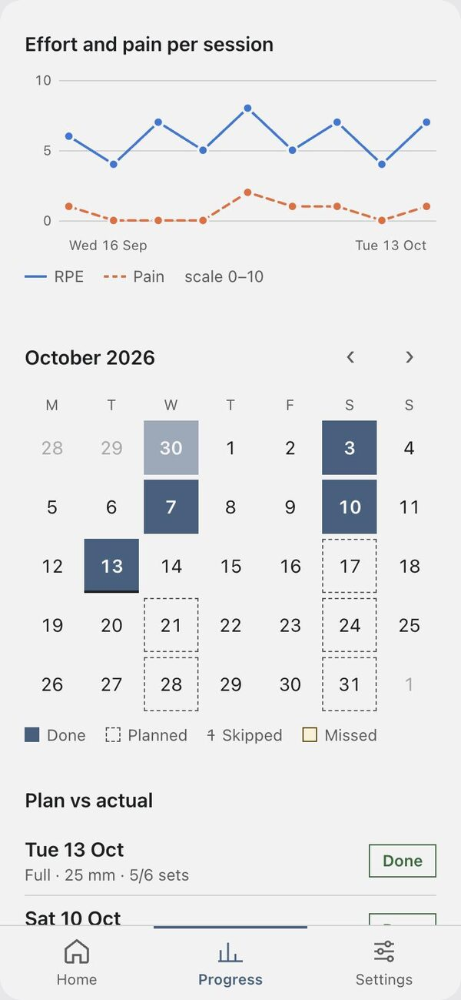
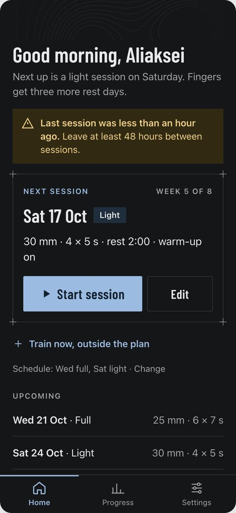

<p align="center">
  
</p>

<h1 align="center">Hangi Tracker</h1>

<p align="center">
  <b>Hangboard sessions, timed and logged.</b><br>
  Open the app, tap Start, put the phone on the floor and hang.
</p>

<p align="center">
  <a href="https://hangi-tracker.aliaksei-zhynhiarouski.workers.dev"><b>Open the app →</b></a>
  &nbsp;·&nbsp;
  <a href="#screenshots">Screenshots</a>
  &nbsp;·&nbsp;
  <a href="#run-it-locally">Run it locally</a>
</p>

<p align="center">
  
</p>

Hangi Tracker is a small web app for finger training on a hangboard. It plans an
8-week program, runs each session with a big, loud timer you can read from two
metres away, saves the result and shows your progress. It installs on the phone's
home screen and keeps working without a network.

**Try it:** open https://hangi-tracker.aliaksei-zhynhiarouski.workers.dev and tap
**Try it without an account**. You get a plan with four weeks of sample history; it
stays in your browser and nothing is sent to a server. On a phone, use "Add to Home
Screen" to install it like an app.

## What it does

- **A plan that is ready when you are.** An 8-week max-hang program with a full and a
  light session each week. The next session is always filled in: two taps from opening
  the app to a running timer.
- **A timer for the floor, not for your hands.** Each phase has its own colour and a
  large label: amber to get ready, chartreuse to hang, deep blue to rest. Beeps count
  down 3-2-1, mark the start and end of every hang, and warn 10 s and 5 s before the
  rest ends. Optional voice prompts. The screen stays on.
- **Edit anything before you start.** Edge, hang time, sets, rest, grip and added
  weight, for the whole session or for a single set. Save the change for this session
  only, or for all next sessions of that type.
- **Your schedule, not the plan's.** Pick your training days like a calendar repeat
  rule (for example Mon full, Wed light, Fri full), move a session to another date
  (the rest of the plan follows), skip a session you will not do, or train now with an
  extra session outside the plan.
- **One tap to log a set.** During rest, mark the last set completed or failed. After
  the session, add effort (RPE), pain and where it hurts, body weight and a note.
  Everything is saved at once.
- **Progress without typing.** Personal records per edge, time under load per week,
  edge and hang time over time, effort and pain per session, a calendar and plan vs
  actual.
- **Suggestions, never orders.** Move to a smaller edge when you are ready, take a step
  back after pain, or go back a week after a break. Each one has Accept and Dismiss.
  A sharp pain, click or pop shows a safety message.
- **Your data, everywhere.** Works offline, syncs to your account when online, and
  exports to a JSON file you can import again. Light and dark theme.
- **Try before an account.** Guest mode with sample data, kept only in the browser.

## Screenshots

| Session preview | Get ready | Rest and set result |
| :---: | :---: | :---: |
|  |  |  |

| Session summary | Charts and calendar | Dark theme |
| :---: | :---: | :---: |
|  |  |  |

## How it is built

| Part | Choice |
| --- | --- |
| App | Svelte 5, TypeScript, Vite, plain CSS from the design tokens |
| Offline | Installable PWA (service worker), IndexedDB as the working store |
| Server | One Cloudflare Worker: serves the app and a small JSON API |
| Database | Cloudflare D1 (SQLite): users and one data snapshot per user |
| Login | Password only, PBKDF2 hashes, signed HttpOnly cookie; guest mode without an account |
| Timer | Pure TypeScript, computed from timestamps, beeps scheduled on the Web Audio clock |
| Charts | Hand-drawn SVG, no chart library |
| Tests | Vitest for the plan, timer, sync and progress logic |

The timer never counts ticks: it computes the phase from the start time, so a locked
screen or a background tab does not make it drift.

## Run it locally

You need Node.js 22 or newer and Python 3.

```bash
npm install
cp .dev.vars.example .dev.vars                          # local session secret
npx wrangler d1 migrations apply hangi-tracker --local  # local database
python3 scripts/add_user.py --local                     # then run the command it prints
npm run preview                                         # build + local Worker
```

Open http://localhost:8787 and log in with the password you chose.

For hot reload while you work on the UI, run the API and the app in two terminals:

```bash
npm run dev:worker   # Worker and API on port 8787
npm run dev          # Vite on port 5173, /api goes to 8787
```

Checks (CI runs the same):

```bash
npm run lint && npm run typecheck && npm test
```

The local database lives in `.wrangler/` and is separate from production.

## Deploy

A push to `main` runs the checks and, when they pass, deploys a new Worker version to
Cloudflare. Setup, versions and rollback: [docs/DEPLOY.md](docs/DEPLOY.md).

## More

- [docs/PLAN.md](docs/PLAN.md): architecture, phases and decisions
- [docs/design/](docs/design/README.md): the design handoff (screens, tokens, assets)
- [docs/HANDOVER.md](docs/HANDOVER.md): current status

The app gives training suggestions. It is not medical advice.
